
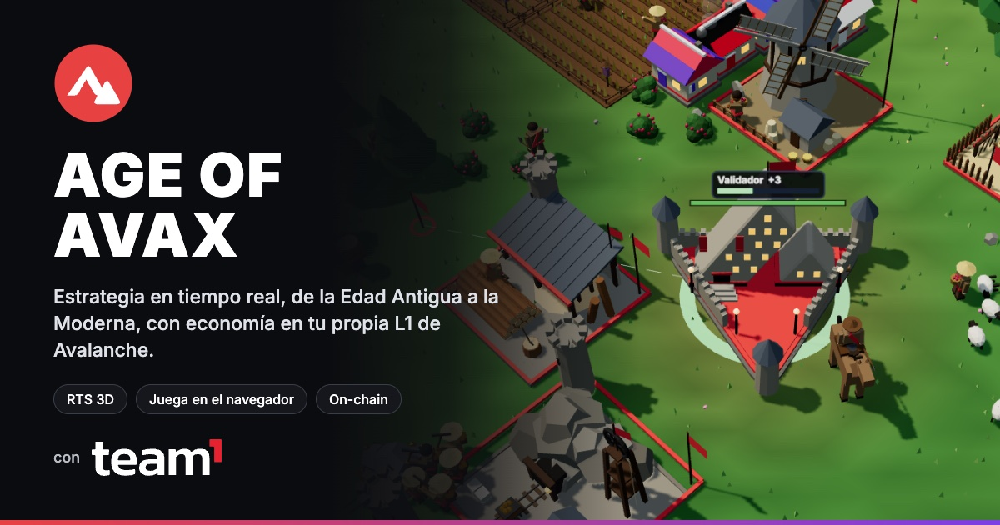

<h1 align="center">Age of Avax</h1>

<b>Estrategia en tiempo real de la Edad Antigua a la Moderna, con economía on-chain en su propia L1 de Avalanche.</b> 
Con <b>Team1</b> · juega gratis en el navegador · conecta tu wallet para ganar GLORY sin pagar gas · 1 vs 1 con salas

<a href="https://age-of-avax.vercel.app"><b>▶ Jugar</b></a> ·
<a href="docs/video/Age-of-Avax-comercial.mp4">Comercial (60 s)</a> ·
<a href="docs/Age_of_Avax_Whitepaper_v1.2_ES.pdf">Whitepaper (ES)</a> ·
<a href="docs/Age_of_Avax_Whitepaper_v1.2_EN.pdf">Whitepaper (EN)</a> ·
<a href="docs/ECONOMIA.md">Economía</a> ·
<a href="docs/MULTIJUGADOR.md">1 vs 1</a>

---

<a href="docs/video/Age-of-Avax-comercial.mp4">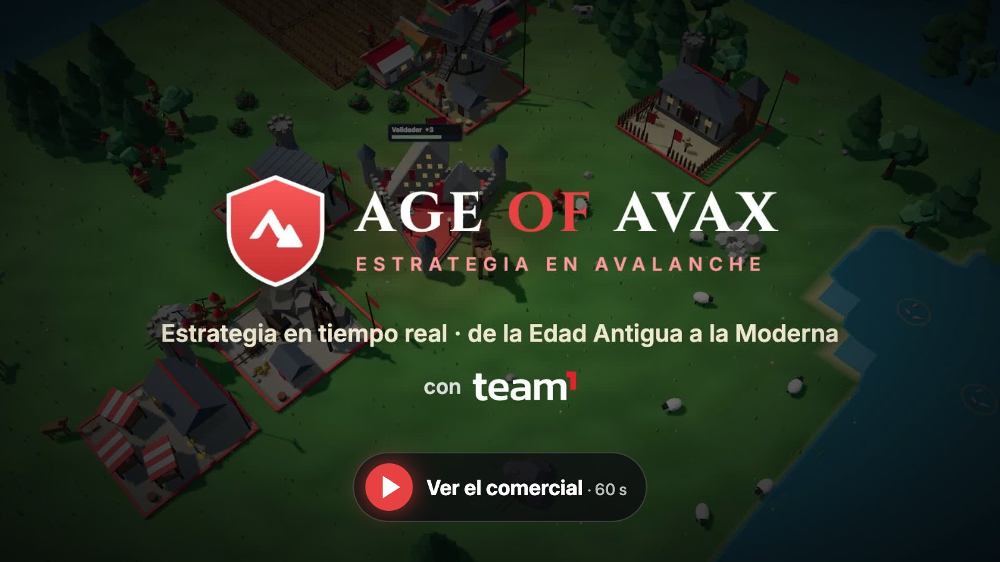</a> 
Comercial de 60 s: <a href="docs/video/Age-of-Avax-comercial.mp4">horizontal</a> · <a href="docs/video/Age-of-Avax-comercial-vertical.mp4">vertical 9:16</a> (estados, Instagram, TikTok). Tomas reales del juego, música generada por código.

## Qué es

Un RTS en 3D con la dinámica clásica de *Age of Empires*: recolectar, construir, avanzar de era y destruir el centro urbano enemigo. Funciona sobre una **L1 propia de Avalanche** (gas token AGE, bloques de 1 s).

- La partida corre en el navegador con una simulación **determinista**: `semilla + comandos` reproduce la partida exacta.
- A la cadena solo va lo que importa: la huella del replay, el ganador, el récord y las recompensas.
- El centro urbano tiene la silueta del logo de Avalanche, la academia tiene la forma de la marca **t1** de Team1, y las casas llevan los colores de los chapters de Team1.

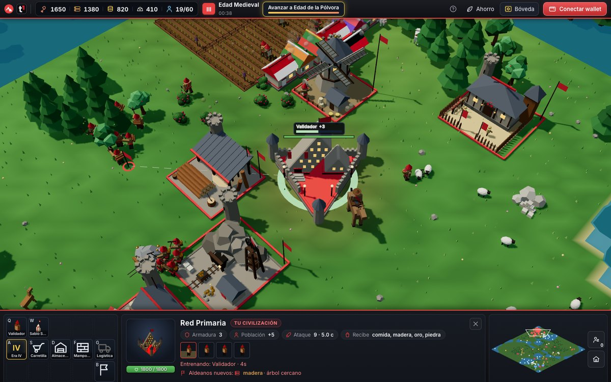 La interfaz en la Edad Medieval. Barra superior: recursos, era con su avance, Bóveda y wallet. Abajo: un solo botón de aldeano, la cola de producción (hasta 10) y el punto de reunión sobre un árbol ("Aldeanos nuevos: madera").

### Interfaz

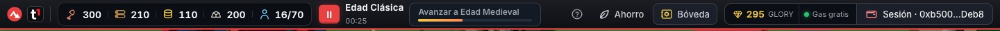 Barra superior con una sesión conectada.

- **Barra superior**, de izquierda a derecha:
  - recursos y población en una sola cápsula;
  - la era con el botón de avance y su progreso;
  - ayuda, modo **Ahorro** y la **Bóveda**;
  - la wallet: tu saldo de GLORY, el indicador de gas gratis y tu email o dirección.

  Es responsiva: en pantallas angostas los textos se esconden y quedan los iconos. En el celular se desliza.
- **Bóveda** (antes "Armería", que se confundía con el cuartel): tus activos on-chain, con cuatro pestañas:
  - **Tienda:** civilizaciones, ejército, planos y skins;
  - **Recursos y pools;**
  - **Mi inventario;**
  - **Mercado P2P.**

  Cada tarjeta muestra el modelo 3D del ítem (el caballero con los colores de la civilización, la unidad, el edificio o la skin aplicada), su rareza, cuántos se han acuñado y el precio.

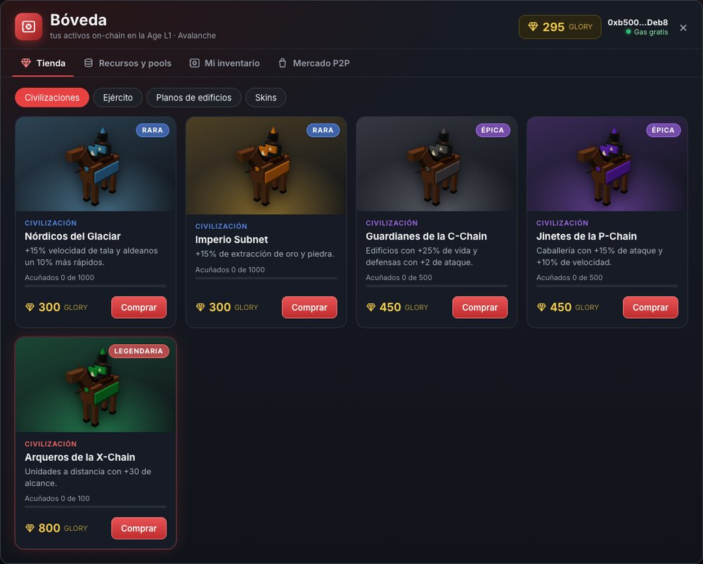 La Bóveda: civilizaciones con su color, rareza, acuñados y precio en GLORY.

- **Confirmaciones on-chain:** antes de firmar aparece una hoja con lo que compras, el precio, tu saldo después, la red y el gas (gratis). Si no te alcanza el GLORY, no te deja firmar.
- **Seguimiento en vivo:** cada transacción muestra en una esquina sus pasos: *Firmando → Enviada → Confirmada en el bloque #N*, con el tiempo que tardó y un enlace a la evidencia en la cadena. Con la wallet de email (Privy) no aparecen ventanas extra: todo se ve en el juego.

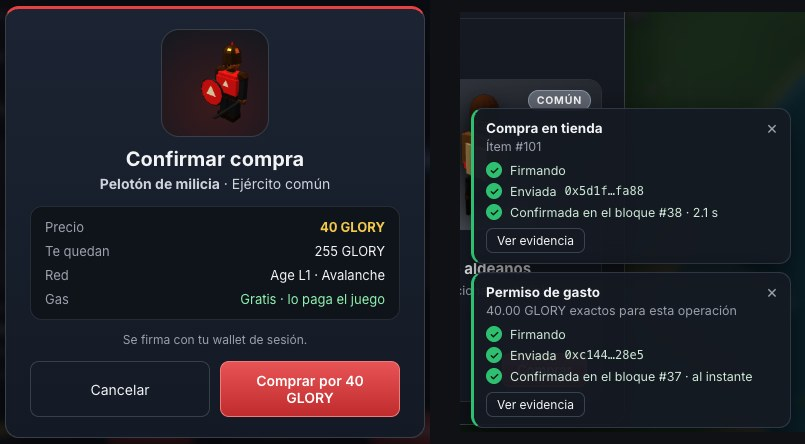 Confirmación de compra y seguimiento: permiso de gasto exacto y compra, cada una confirmada en su bloque.

### Primera partida, fin de partida y comunidad

- **Intro y landing:** al abrir el juego aparece una portada a pantalla completa con el juego en movimiento de fondo, el logo animado y un botón **JUGAR**. Bajando: las siete eras, clips de batallas, la Era Futurista, el mar y la Maravilla, cómo funciona lo on-chain (email, sin gas, GLORY, NFT) y cómo se juega, con animaciones al hacer scroll y el tráiler. Los enlaces de invitación a una sala la saltan.

- **Partidas guardadas:** la partida contra la IA se guarda sola cada 4 s y al cerrar o salir de la pestaña. Si vuelves (aunque hayas cerrado el navegador), aparece **«Tienes una partida sin terminar»** con *Continuar* y *Descartar*: el juego repite tus órdenes desde la misma semilla y queda exactamente donde la dejaste, con tu sesión del Mercado. El botón Atrás del navegador pregunta antes de salir. Como solo se guardan la semilla y tus órdenes, pesa muy poco y 30 minutos de partida se restauran en unos segundos.
- **Tutorial:** la primera vez que juegas, seis pasos guiados que avanzan solos cuando haces lo que piden: seleccionar aldeanos, recolectar, construir un Refugio Alpino, entrenar aldeanos, preparar el ejército y atacar. El botón que toca usar parpadea en rojo. Se puede saltar y volver a ver con `?tutorial`.

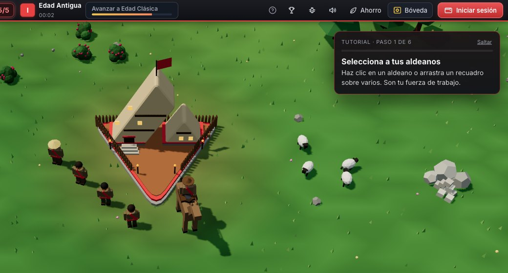 Paso 1 del tutorial, arriba a la derecha.

- **Victoria y derrota:** al caer un centro urbano, la cámara viaja hasta él para ver el derrumbe y aparece la pantalla final: escudo dorado con laureles, confeti y fanfarria si ganas; escudo roto, ceniza y el mundo en gris si pierdes. Dice cómo terminó (centro urbano destruido, rendición o Maravilla) y muestra duración, era, aldeanos, ejército y edificios. Desde ahí se cobra el GLORY y se venden los recursos.

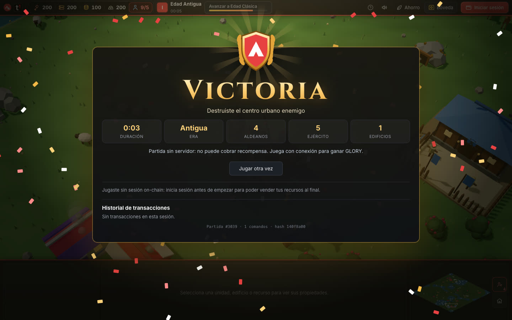 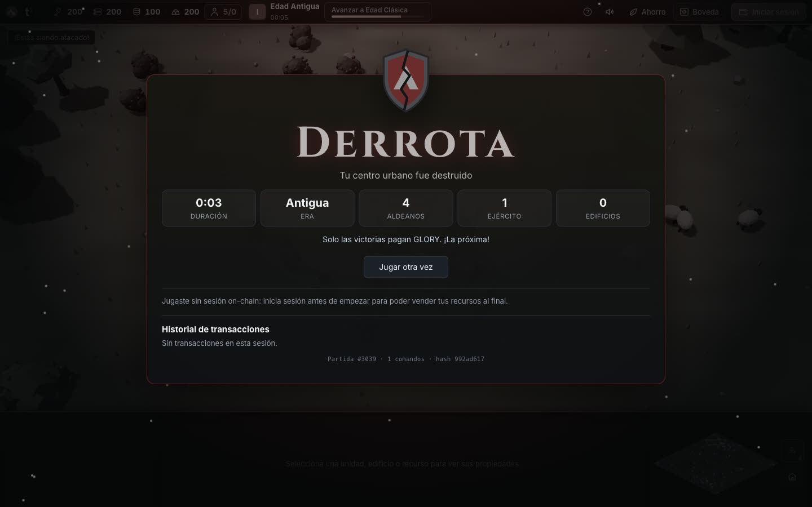 Pantallas de victoria y derrota.

- **Barra de producción** (arriba a la izquierda, como el resumen de AoE2 DE): todo lo que se está entrenando o investigando, agrupado por tipo: icono, total en cola entre todos tus edificios y el avance del siguiente. Si la población está llena, la ficha se pone ámbar. Un clic selecciona el edificio que lo produce (y rota entre varios).
- **Marcador en vivo** (como en AoE2, sobre el minimapa): tu color y número, tu nombre, el puntaje y la era de cada jugador, ordenados por puntaje. El puntaje suma economía (recursos juntados), militar (valor de lo que destruiste al rival), lo que tienes en pie y la tecnología (eras y mejoras). `F4` lo oculta. Al final de la partida aparece el puntaje de ambos.
- **Clasificación** (icono de trofeo): los mejores jugadores por GLORY cobrado y victorias, contra la IA y en 1 vs 1. Se calcula con los eventos `RewardClaimed` del MatchRegistry, así que cualquiera puede verificarla en la cadena.
- **Reportar un problema** (icono de insecto): el jugador cuenta qué pasó y se adjunta la partida en curso (mapa, semilla y sus órdenes), los últimos errores de la página y su pantalla y navegador. Como la simulación es determinista, con eso se reproduce exacto: `npx tsx scripts/reportes.ts` los lista y `?reporte=<id>` (en desarrollo) vuelve a jugar esa partida hasta 20 s antes del reporte.

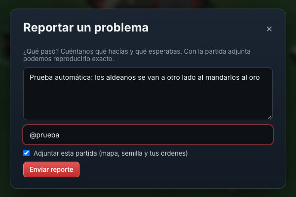 Reportar un problema, con la partida adjunta.

## Eras

Como en AoE, **cada era cambia el aspecto de los edificios** y desbloquea unidades, edificios y mejoras. El avance se investiga en la Red Primaria.

<table><tr><td align="center">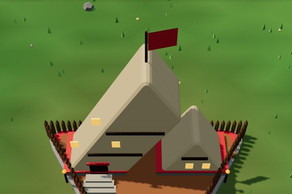 <b>I</b> · Antigua</td><td align="center">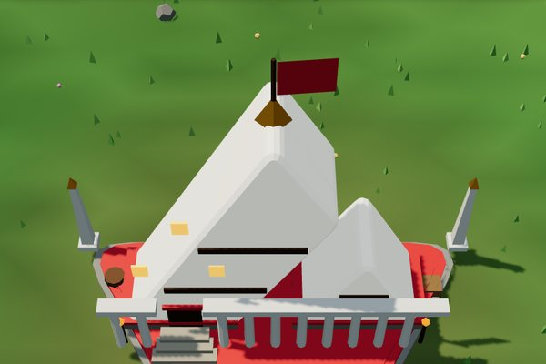 <b>II</b> · Clásica</td><td align="center">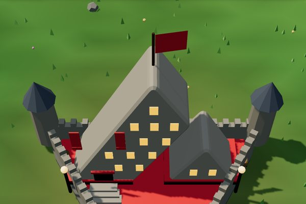 <b>III</b> · Medieval</td><td align="center">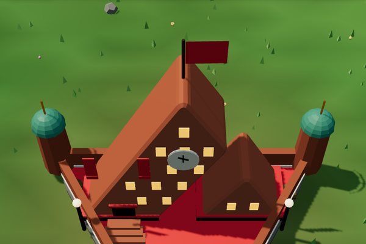 <b>IV</b> · Pólvora</td><td align="center">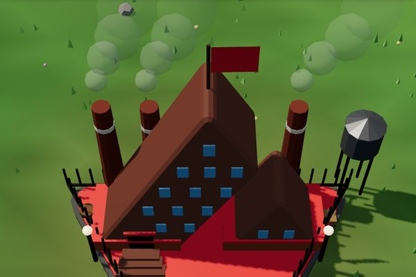 <b>V</b> · Industrial</td><td align="center">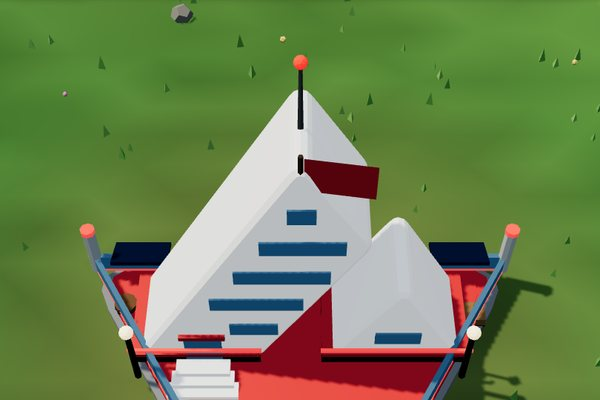 <b>VI</b> · Moderna</td><td align="center">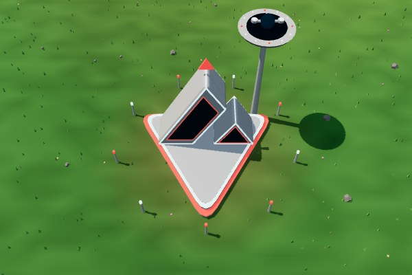 <b>VII</b> · Futurista</td></tr></table>

| Era | Avance (costo) | Nuevos edificios | Nuevas unidades | Nuevas mejoras |
|---|---|---|---|---|
| **I · Antigua** | — | Red Primaria, Refugio Alpino, Granero del Nodo, Aserradero Firewood, Mina de AVAX, Granja de Staking, Mercado DeFi, Puerto Teleporter, Cuartel del Consenso, Empalizada de Hielo | Validador, Centinela, Pesquero Coreth, Transbordador ICM | Hacha doble |
| **II · Clásica** | 400 🍖 · 100 🪵 | Galería Snowball, Establo Snowflake, Forja HyperSDK, Torre Validadora, Muralla Glaciar | Tirador Snowball, Explorador Snowflake, Sabio Snowman, Carguero Interchain, Galera Avalanche | Carretilla, Arado, Pico minero, Forja |
| **III · Medieval** | 700 🍖 · 300 🪙 | Taller de Subnets, Fortaleza L1 | Caballero Avalanche, Catapulta Glaciar | Armadura de placas, Collera, Sierra de arco, Almacenes, Mampostería |
| **IV · de la Pólvora** | 900 🍖 · 600 🪙 · 200 🪨 | Academia Team1, Templo del Consenso (maravilla) | Mosquetero C-Chain, Cañón Subnet | Balística, Minería profunda, Altos hornos |
| **V · Industrial** | 1200 🍖 · 900 🪙 · 400 🪨 | Fábrica Avalanche9000 | Fusilero Warp | Química, Rotación de cultivos, Blindaje, Cadena de montaje |
| **VI · Moderna** | 1500 🍖 · 1200 🪙 · 600 🪨 | — | Tanque Avalanche9000 | Logística, Guiado de precisión |
| **VII · Futurista** | 2000 🍖 · 1600 🪙 · 800 🪨 | — (todos se vuelven futuristas) | Mecha Validador, Halcón Interchain, Tanque de Plasma Etna | — |

Como en AoE, cada era cambia el aspecto de los edificios. Los techos y los muros cambian de material y aparece un elemento icónico de la época. Desde la era III, el color del equipo pasa de los techos a un borde alrededor del edificio y a un estandarte. Al subir de era, el juego anuncia lo que se desbloqueó.

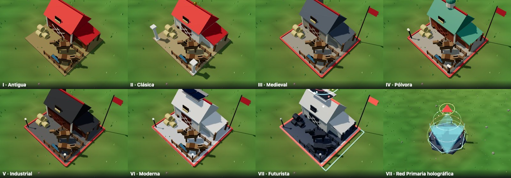

| Era | Muros | Techos | Elemento icónico |
|---|---|---|---|
| I · Antigua | madera y yeso | color del equipo | — |
| II · Clásica | mármol blanco | color del equipo | columnas clásicas y remate dorado |
| III · Medieval | piedra | pizarra azul | torreón con almenas |
| IV · Pólvora | ladrillo rojo | cobre verde | cúpula de cobre y faroles |
| V · Industrial | ladrillo oscuro | zinc | chimenea industrial con humo |
| VI · Moderna | concreto claro | blanco | paneles solares y antena con luz roja |
| VII · Futurista | cerámica blanca y grafito sobre losas de pizarra | vidrio oscuro | aristas de neón, franja de luz al ras del suelo y un anillo holográfico que gira encima; la Red Primaria es una estructura blanca estilo *Oblivion*, más grande que las demás, con vidrio negro y LED en las aristas del logo |

### VII · Edad Futurista

La era más futurista posible: la **Red Primaria** se vuelve una estructura blanca estilo *Oblivion*, más grande que las demás, con paneles de vidrio negro, luces LED en todas las aristas del logo, postes de luz y una torre esbelta con helipuerto. Todos los edificios se rehacen en cerámica blanca, grafito y vidrio oscuro, con aristas de neón y un anillo holográfico. Llegan los **robots de combate**, los **helicópteros de ataque**, que vuelan sobre agua, bosques y murallas, y los **tanques de plasma**, que levitan. Todos disparan **láser**: cian los tuyos y magenta los del rival.

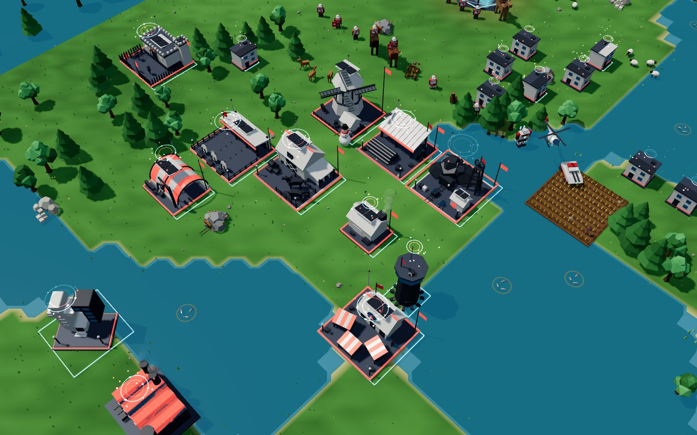 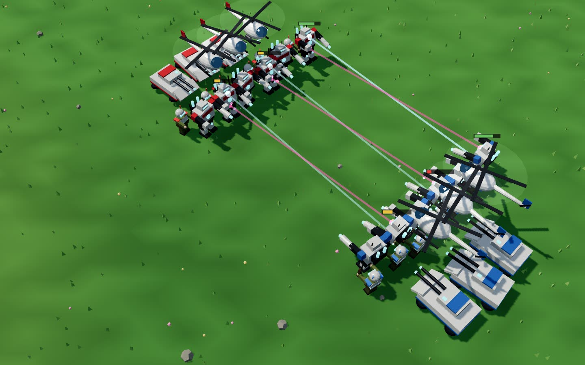 Una base en la Edad Futurista y una batalla de robots, tanques de plasma y helicópteros.

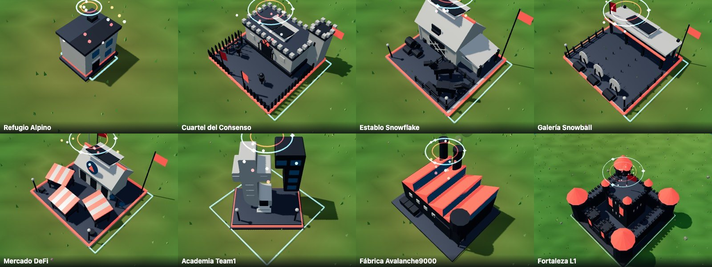 Los edificios en la Edad Futurista: cerámica blanca, grafito, pisos de pizarra, neón del color del equipo y un anillo holográfico encima.

Al avanzar de era se levanta sobre la Red Primaria una **columna de luz roja con el triángulo de Avalanche**, con una onda expansiva y un estallido de partículas.

### Personajes por era

Las personas también cambian de equipo con cada era, y el triángulo de Avalanche aparece en escudos, tabardos y brazaletes.

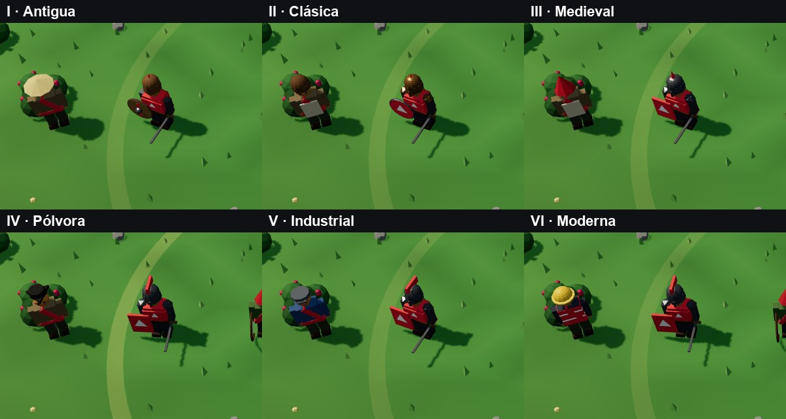 Aldeano y Centinela en las siete eras (en la Futurista, casco blanco con visor de luz cian y peto blanco) y el robot de combate.

| Era | Aldeano | Centinela (milicia) | Otros |
|---|---|---|---|
| I | sombrero de paja | casco de cuero y escudo de madera | — |
| II | gorra de cuero y delantal | casco de bronce, escudo del equipo con el triángulo | — |
| III | capucha del color del equipo | acero, escudo de cometa y capa larga | arquero con capucha del equipo |
| IV | tricornio | cresta en el casco | caballero con penacho alto y capa |
| V | gorra de obrero y overol | — | — |
| VI | casco de obra y chaleco reflectante | — | fusilero con visor |

**Animaciones:**
- tajo con carga y recuperación (milicia);
- estocada con la lanza (caballería);
- el arquero tensa la cuerda y la suelta al disparar;
- retroceso de mosquetes y rifles;
- en reposo, las unidades miran a su alrededor;
- al morir caen al suelo en vez de desaparecer.

### Efectos

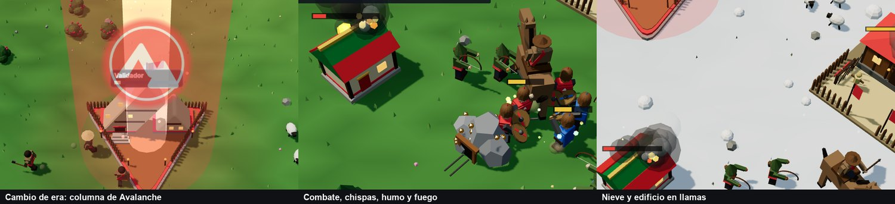 Cambio de era, combate con chispas, edificios en llamas y nieve.

- **Trabajo:** astillas al talar, chispas doradas al minar oro, lascas al picar piedra, tierra al cultivar y polvo al construir. Salen justo cuando cae cada golpe.
- **Movimiento:** polvo al caminar (más con la caballería y el asedio) y estela de espuma detrás de los barcos.
- **Combate:**
  - destellos y chispas en cada golpe;
  - flechas con rastro;
  - humo al disparar mosquetes y cañones;
  - explosión al impactar el asedio.
- **Daño:** los edificios echan humo por debajo del 60 % de vida y se incendian por debajo del 30 %.
- **Destrucción:**
  - los edificios se derrumban entre polvo y escombros;
  - los árboles talados caen;
  - los barcos se hunden.
- **Avalanche:**
  - columna con el triángulo al cambiar de era;
  - portal rojo **Teleporter** por el que salen los barcos del muelle;
  - aura del Sabio Snowman y destellos al curar;
  - nieve que cae en el mapa Nieve.

Las partículas se dibujan en tres mallas instanciadas (un draw call cada una) y solo cerca de la cámara, así que no bajan el rendimiento.

## Edificios

| | Edificio | Era | Costo | Qué hace |
|---|---|---|---|---|
|  | **Red Primaria** Centro urbano | I | 275 🪵 · 100 🪨 | Corazón de la civilización. Entrena aldeanos, recibe todos los recursos y avanza de era. |
| 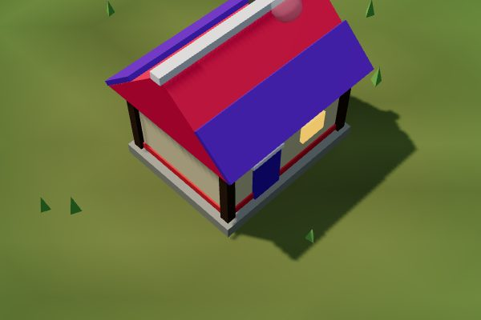 | **Refugio Alpino** Casa | I | 30 🪵 | Aumenta la población máxima en 5. Cabe en una casilla: se construye en filas seguidas, pegada a otras casas. |
| 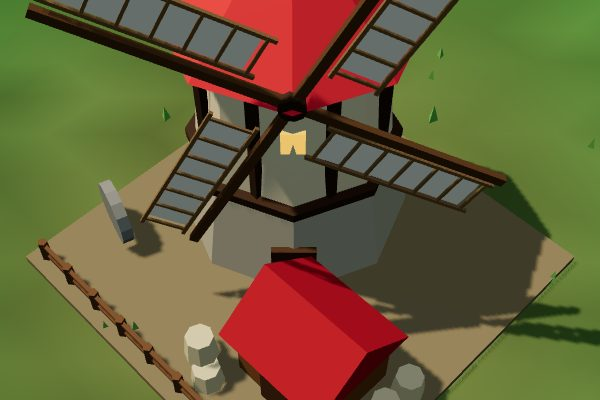 | **Granero del Nodo** Molino | I | 100 🪵 | Punto de entrega de comida. Investiga mejoras agrícolas. |
| 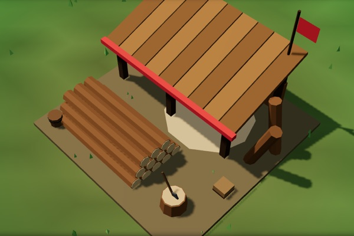 | **Aserradero Firewood** Aserradero | I | 100 🪵 | Punto de entrega de madera. Investiga mejoras de tala. Ocupa una casilla, del tamaño de una casa; se reconoce por su techo de tablones y la pila de troncos. |
| 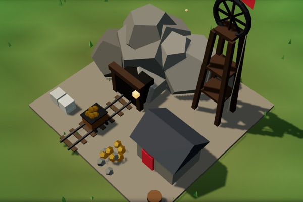 | **Mina de AVAX** Campamento minero | I | 100 🪵 | Punto de entrega de oro y piedra. Investiga mejoras de minería. Ocupa una casilla, del tamaño de una casa; se reconoce por el montículo de roca con túnel y la torre con polea. |
| 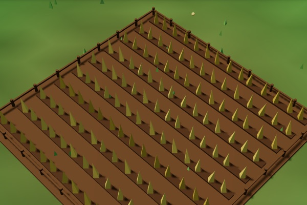 | **Granja de Staking** Granja | I | 60 🪵 | Fuente renovable de comida. Un aldeano la trabaja. Al agotarse se vuelve a sembrar sola por 60 🪵 (si no hay madera, desaparece). |
| 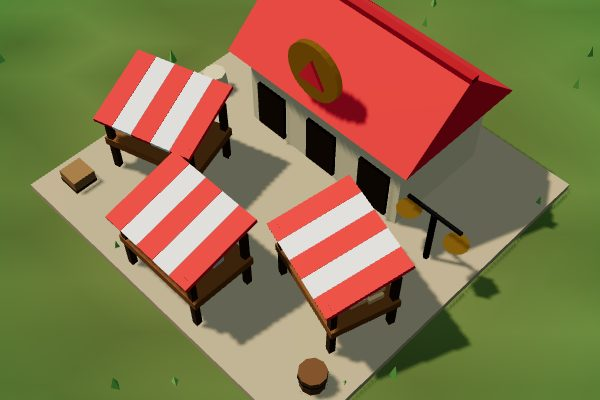 | **Mercado DeFi** Mercado | I | 175 🪵 | Compra y vende comida, madera y piedra por oro (los precios suben al comprar y bajan al vender). Entrena carretas comerciantes. |
| 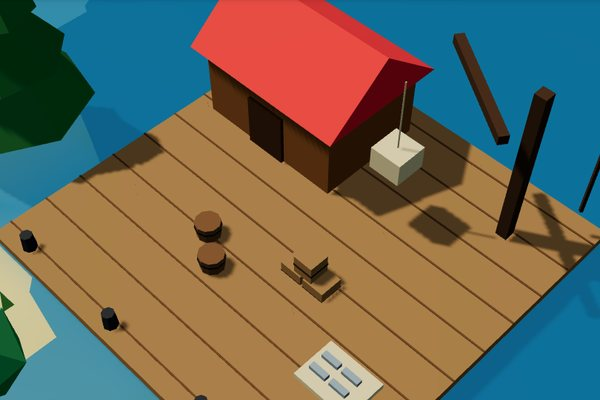 | **Puerto Teleporter** Muelle | I | 150 🪵 | Se construye en la orilla, sobre el agua. Entrena los cuatro barcos y recibe el pescado. |
| 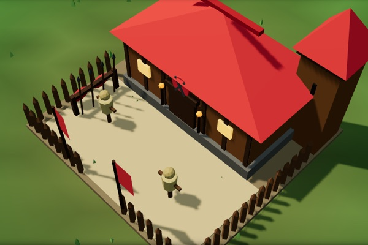 | **Cuartel del Consenso** Cuartel | I | 100 🪵 · 40 🪨 | Entrena infantería: milicia, mosqueteros y fusileros. Se reconoce por su techo de pabellón, la torre de guardia y el patio de arena. |
| 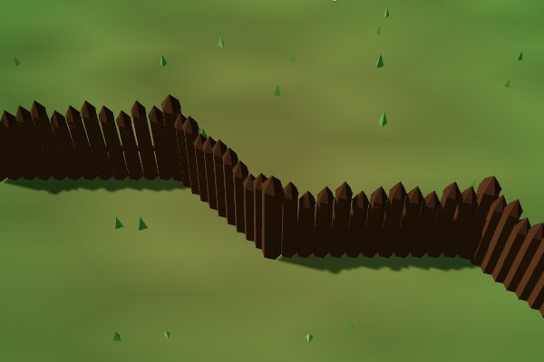 | **Empalizada de Hielo** Empalizada | I | 3 🪵 | Muro barato de troncos. Arrastra para trazar una línea. |
| 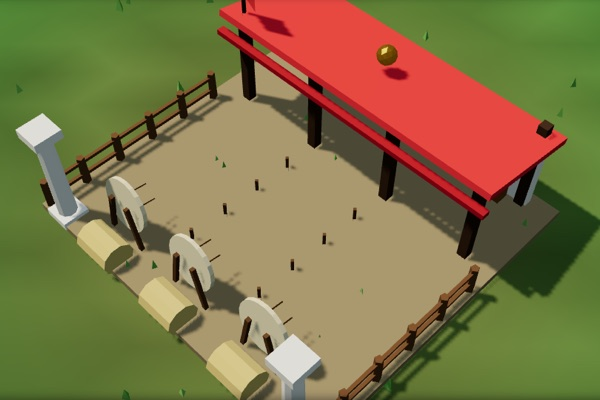 | **Galería Snowball** Galería de tiro | II | 175 🪵 | Entrena arqueros. |
| 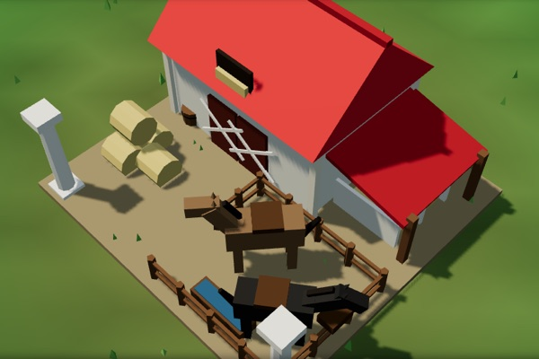 | **Establo Snowflake** Establo | II | 175 🪵 | Entrena caballería: exploradores y caballeros. |
| 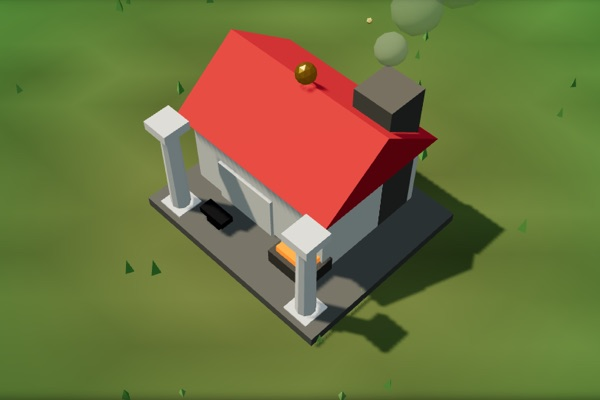 | **Forja HyperSDK** Herrería | II | 150 🪵 | Investiga mejoras de ataque y armadura. |
| 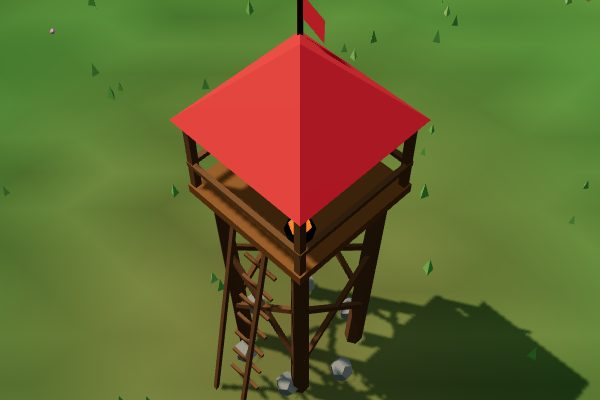 | **Torre Validadora** Torre de vigilancia | II | 50 🪵 · 125 🪨 | Dispara automáticamente a los enemigos cercanos. |
| 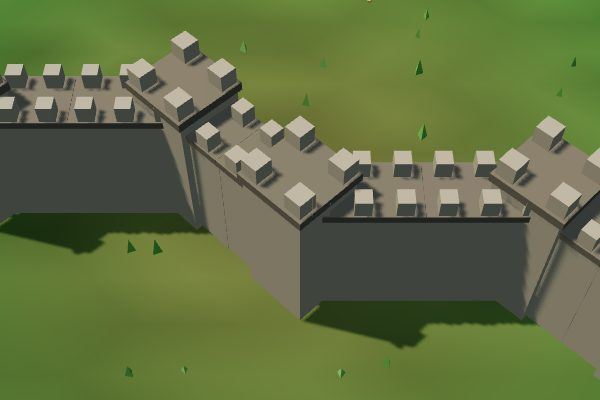 | **Muralla Glaciar** Muralla de piedra | II | 5 🪨 | Muro resistente de piedra. Arrastra para trazar una línea. |
| 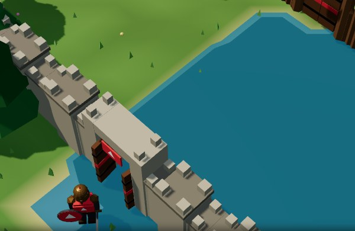 | **Puerta Glaciar** Puerta | I | 40 🪵 | Va dentro de una empalizada o muralla: se coloca sobre un tramo propio (lo reemplaza) o en un hueco. Tus unidades pasan y la puerta se abre sola; las enemigas no. Es de troncos en una empalizada y un torreón de piedra en una muralla. |
| 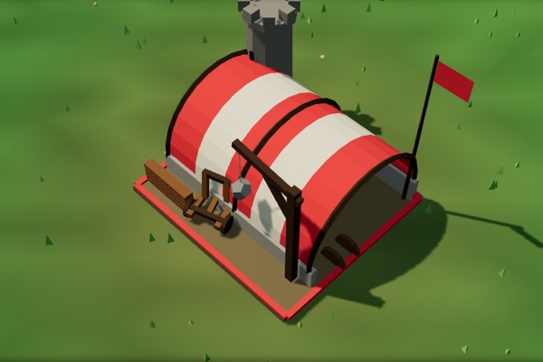 | **Taller de Subnets** Taller de asedio | III | 200 🪵 · 50 🪙 | Construye catapultas y cañones. Se reconoce por su techo curvo de lona a rayas y la grúa. |
| 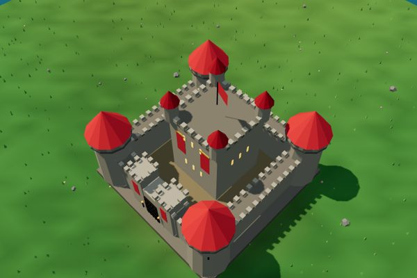 | **Fortaleza L1** Castillo | III | 650 🪨 | Fortaleza de piedra. Dispara a los enemigos, aloja 20 de población y entrena caballeros y catapultas. |
| 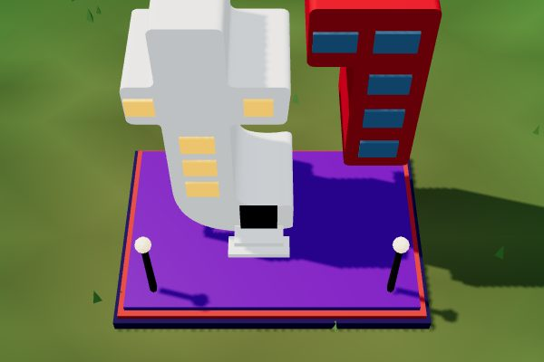 | **Academia Team1** Universidad | IV | 200 🪵 · 100 🪙 · 100 🪨 | Investiga balística y química para las unidades a distancia. |
| 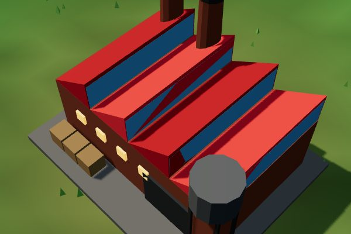 | **Fábrica Avalanche9000** Fábrica | V | 300 🪵 · 200 🪙 · 200 🪨 | Produce cañones y tanques en masa. |
| 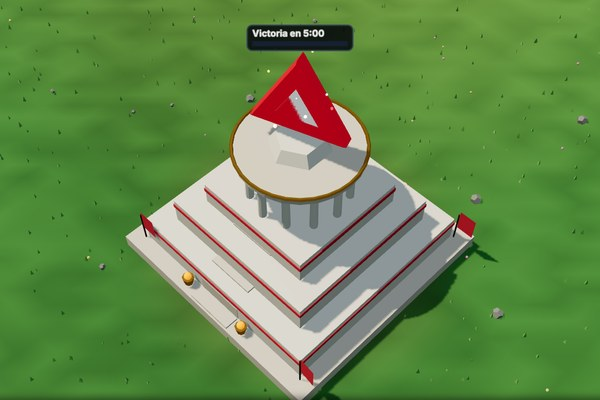 | **Templo del Consenso** Maravilla | IV | 1000 🪵 · 1000 🪙 · 1000 🪨 | **Victoria alternativa:** si resiste en pie 5 minutos después de terminarse, ganas la partida. Ambos jugadores ven la cuenta atrás sobre el templo y reciben avisos cada minuto. La IA ataca la maravilla con todo lo que tiene. |

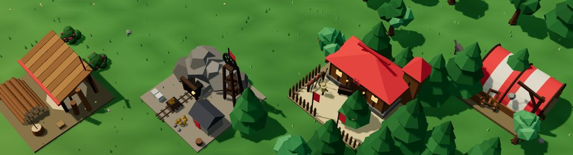 Cada edificio se reconoce desde arriba. De izquierda a derecha: aserradero (techo de tablones y troncos), campamento minero (rocas, túnel y torre con polea), cuartel (techo de pabellón y patio de arena) y taller de asedio (lona a rayas y grúa).

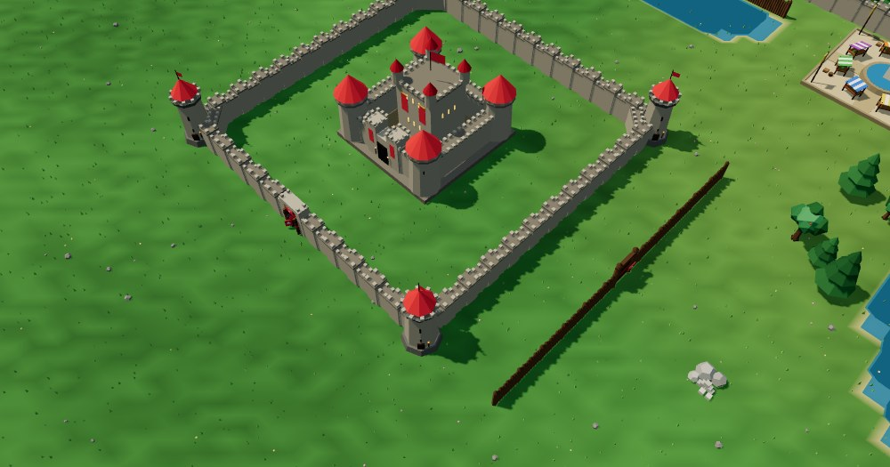 Puerta de troncos en una empalizada (cerrada) y torreón con puerta en la muralla, abierta porque pasa un soldado propio.

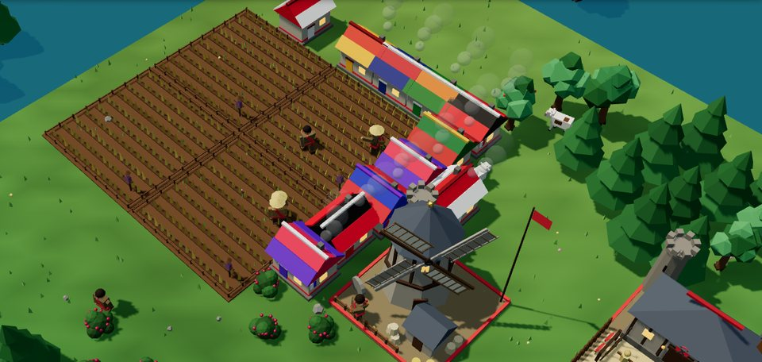 Las granjas llenan su terreno de 3×3 casillas y se construyen pegadas, como las casas: varias forman una parcela continua junto al molino. Al agotarse se resiembran solas por 60 🪵.

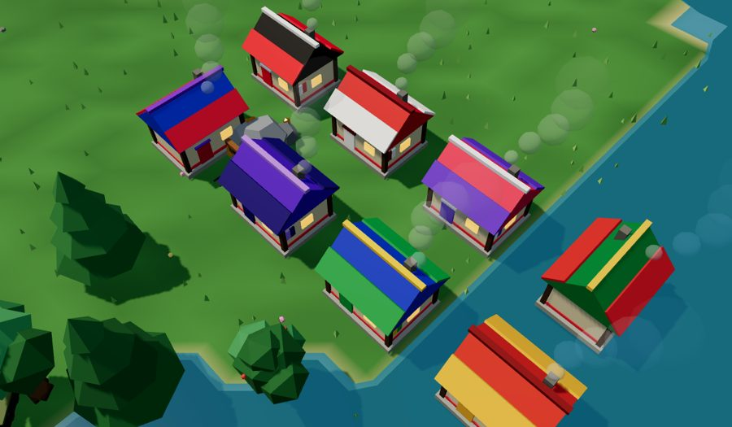 Refugios Alpinos con los colores de los chapters de Team1 (Global, Africa, Brazil, India, Korea, LatAm, Thailand, Turkiye, United States, Vietnam). La franja al pie del muro indica el dueño.

## Unidades

| | Unidad | Era | Costo | Vida · Ataque · Alcance | Qué hace |
|---|---|---|---|---|---|
| 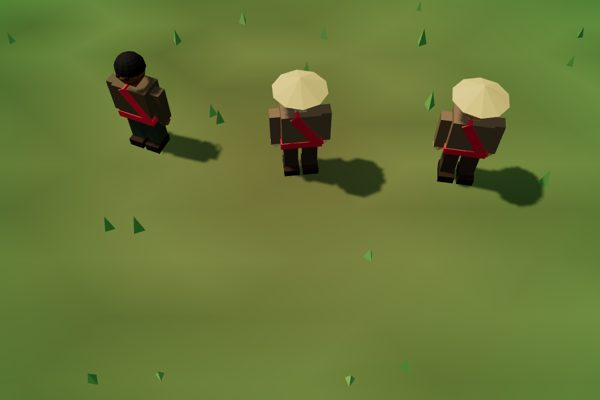 | **Validador** Aldeano | I | 50 🍖 | 40 · 3 · cuerpo a cuerpo | Recolecta recursos, construye y repara edificios. |
| 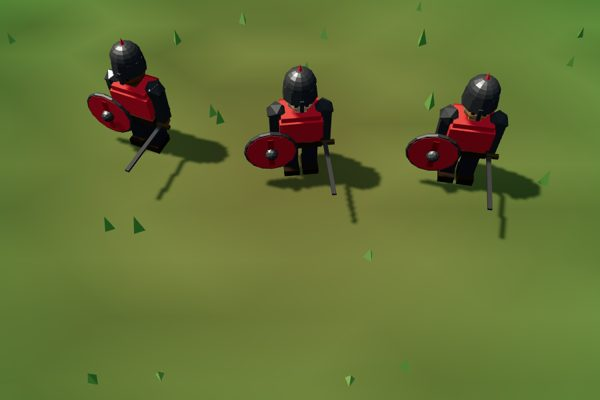 | **Centinela** Milicia | I | 60 🍖 · 20 🪙 | 90 · 10 · cuerpo a cuerpo | Infantería cuerpo a cuerpo, barata y versátil. |
| 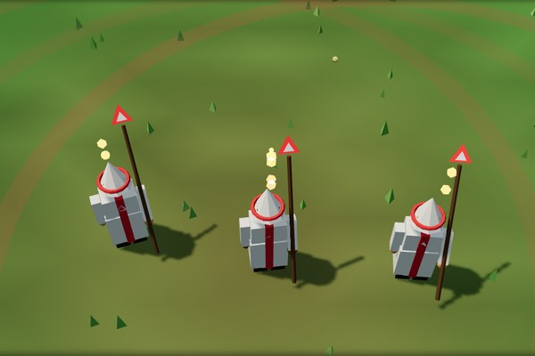 | **Sabio Snowman** Monje | II | 100 🪙 | 45 · — · aura de 3 casillas | Apoyo: cura 2,5 de vida por segundo a cada aliado herido a su alrededor (no a barcos ni asedio). No ataca: con una orden de ataque acompaña a la tropa. Se entrena en la Red Primaria. |
|  | **Tirador Snowball** Arquero | II | 40 🪵 · 40 🪙 | 60 · 7 · 3.8 casillas | Ataca a distancia. Débil en combate cercano. |
|  | **Explorador Snowflake** Explorador | II | 80 🍖 | 100 · 6 · cuerpo a cuerpo | Caballería ligera y muy rápida. Ideal para explorar y cazar aldeanos. |
|  | **Caballero Avalanche** Caballero | III | 70 🍖 · 80 🪙 | 180 · 14 · cuerpo a cuerpo | Caballería pesada con gran armadura y ataque. |
|  | **Catapulta Glaciar** Catapulta | III | 160 🪵 · 120 🪙 | 120 · 30 · 6.0 casillas | Arma de asedio. Triple daño contra edificios. |
|  | **Mosquetero C-Chain** Mosquetero | IV | 60 🍖 · 60 🪙 | 100 · 18 · 4.3 casillas | Infantería con armas de fuego de largo alcance. |
|  | **Cañón Subnet** Cañón | IV | 150 🪵 · 200 🪙 | 160 · 45 · 7.0 casillas | Artillería pesada. Triple daño contra edificios. |
|  | **Fusilero Warp** Fusilero | V | 70 🍖 · 70 🪙 | 120 · 22 · 5.0 casillas | Infantería moderna con rifle de cerrojo. |
|  | **Tanque Avalanche9000** Tanque | VI | 100 🪵 · 250 🪙 · 50 🪨 | 450 · 50 · 5.5 casillas | Blindado moderno. Resistente y devastador. |
|  | **Mecha Validador** Robot de combate | VII | 90 🍖 · 140 🪙 | 260 · 30 · 4.8 casillas | Mecha bípedo con cañón láser. Blindado y preciso. Se entrena en el Cuartel. |
|  | **Halcón Interchain** Helicóptero de ataque | VII | 120 🪵 · 260 🪙 | 230 · 26 · 5.3 casillas | **Vuela**: cruza agua, bosques y murallas en línea recta. Rápido y letal contra tropas. Se entrena en la Fábrica. |
|  | **Tanque de Plasma Etna** Tanque de plasma | VII | 120 🪵 · 320 🪙 · 80 🪨 | 620 · 70 · 6.3 casillas | Levita sobre propulsores de luz. Su cañón de plasma hace 2,5× de daño a edificios. Se entrena en la Fábrica. |
|  | **Pesquero Coreth** Bote pesquero | I | 75 🪵 | 60 · — · — | Pesca en mares, lagos y ríos y lleva la comida al muelle (carga 15). |
|  | **Transbordador ICM** Barco de transporte | I | 125 🪵 | 160 · — · — | Lleva hasta 5 unidades por el agua, por ejemplo de una isla a otra. |
|  | **Caravana DeFi** Carreta comerciante | II | 100 🍖 · 50 🪙 | 70 · — · — | Se entrena en el Mercado. Va y vuelve entre tu Mercado y el Gran Bazar del centro: cada llegada da oro según la distancia. No pelea. |
|  | **Carguero Interchain** Barco mercante | II | 100 🪵 · 50 🪙 | 120 · — · — | Comercia entre dos muelles tuyos: cada viaje da oro según la distancia. |
|  | **Galera Avalanche** Galera de ataque | II | 140 🪵 · 50 🪙 | 200 · 9 · 4.8 casillas | Barco de guerra con arqueros: ataca barcos, costas y edificios. |

### Gran Bazar

En el centro de cada mapa hay una plaza de comercio **neutral**: no es de nadie, no se construye ni se puede destruir. Manda **carretas comerciantes** desde tu Mercado (clic derecho en el bazar, o *Comerciar*): cada viaje da oro según la distancia. Como el viaje tarda en proporción a la distancia, el oro por minuto es el mismo para los dos jugadores aunque el bazar no quede exactamente al centro. El mapa ahora termina en una cornisa de piedra clara, sin bosque decorativo afuera.

 El Gran Bazar: fuente, obelisco con el triángulo de Avalanche y puestos con los colores de los chapters.

### Agua y barcos

 Puerto Teleporter con su flota: galera de ataque, barco mercante, transporte y bote pesquero, junto a dos bancos de peces.

- **Muelle:** se coloca sobre el agua tocando la orilla. Los aldeanos lo construyen desde la costa.
- **Barcos:** navegan por mares, lagos, ríos y vados. No entran a tierra.
- **Peces:** hay bancos en todos los mapas con agua, en espejo para ambos jugadores, y siempre uno cerca de cada base. Solo los botes pesqueros los recolectan. Con el punto de reunión del muelle sobre un banco, los botes nacen pescando.
- **Transporte:**
  - para subir: selecciona unidades y haz clic derecho sobre el barco;
  - para desembarcar: con el barco seleccionado, clic derecho en la costa. Navega a la orilla más cercana y baja a todos.
  - Si el transporte se hunde, los pasajeros se hunden con él.
- **Comercio:** con el mercante seleccionado, clic derecho sobre otro muelle tuyo. Va y vuelve entre ambos y cobra oro en cada llegada; cuanto más lejos estén los muelles, más oro.
- **Combate naval:** la galera dispara flechas a barcos, unidades en la costa y edificios. Los barcos civiles no combaten.

## Civilizaciones

| Civilización | Bonificación | Cómo se obtiene |
|---|---|---|
| **Pioneros de Avalanche** | Identidad Avalanche (Validador, Red Primaria, Mina de AVAX…), sin bonificaciones | Gratis |
| Nórdicos del Glaciar | +15% tala, aldeanos +10% velocidad | NFT 201 |
| Imperio Subnet | +15% oro y piedra | NFT 202 |
| Guardianes de la C-Chain | Edificios +25% vida, defensas +2 ataque | NFT 203 |
| Jinetes de la P-Chain | Caballería +15% ataque, +10% velocidad | NFT 204 |
| Arqueros de la X-Chain | +30 alcance a distancia | NFT 205 |

## Cómo se juega

- **Recursos:** comida (bayas, ovejas, vacas, ciervos, jabalíes, granjas), madera, oro y piedra. Mapas con mucho bosque y minas repartidas para expandirse.
- **Fauna:**
  - ganado: ovejas y vacas;
  - ciervos;
  - jabalíes: se defienden cuando los cazas, mejor entre dos aldeanos;
  - lobos: atacan a quien se acerque.

  Los aldeanos se defienden solos y luego vuelven a su tarea.
- **Punto de reunión y actividad al nacer:** hay un solo botón de aldeano. Con un edificio seleccionado, haz clic derecho:
  - sobre un árbol, una mina, bayas o una granja, los aldeanos nuevos nacen con esa actividad y se reparten entre los recursos de alrededor;
  - sobre un enemigo, los militares lo atacan.
- **Cola de producción:** hasta 10 unidades por edificio.
- **Agua:**
  - muelle, botes pesqueros, transportes, mercantes y galeras de ataque;
  - peces en mares, lagos y ríos (ver *Agua y barcos*).
- **Granjas:**
  - ocupan 3×3 casillas y se construyen pegadas, formando una parcela;
  - al agotarse se resiembran solas por 60 🪵.
- **Movimiento:** los aldeanos caminan entre los árboles, cruzan sus propios edificios, se reparten alrededor de cada recurso y no se traban.
- **Unidades atascadas:** si una unidad lleva 2 segundos intentando caminar sin avanzar, se destraba sola. Si quedó parada dentro de algo que no puede pisar (una torre o muralla que se construyó encima, un árbol, un edificio enemigo), sale a la casilla libre más cercana; si está encajonada, recalcula la ruta colándose entre los árboles. Si quedó encerrada en un hueco de pocas casillas por edificios y árboles, salta a la casilla libre de al lado. Los cercos grandes hechos a propósito con murallas siguen funcionando.
- **Murallas y puertas:**
  - nadie atraviesa una empalizada ni una muralla;
  - si un destino queda encerrado, la unidad va al punto más cercano al que sí puede llegar;
  - los tuyos pasan por tus puertas; el rival no puede;
  - un ejército bloqueado ataca el tramo o la puerta que le cierra el paso y entra por la brecha, como en AoE.
- **Sumideros por era:** mejoras escalonadas, reparar cuesta el 50% del edificio, y el almacén tiene tope (el excedente se merma).
- **Indicaciones visuales:** cartel de entrenamiento sobre el edificio, aviso de población llena, recursos que faltan en rojo y aviso de recurso agotado.
- **Cámara:**
  - lleva el mouse a cualquier borde de la ventana, como en AoE;
  - o usa dos dedos en el trackpad;
  - pellizcar hace zoom.
- **Controles:**
  - clic con dos dedos (o clic derecho) da órdenes;
  - panel con QWERT/ASDFG/ZXCVB;
  - H: centro urbano · punto: aldeano inactivo · Ctrl+1..9: grupos.
- **Cursor:** el triángulo de Avalanche.
- **Sonido:** se sintetiza en el navegador, sin archivos de audio. El volumen baja con la distancia a la cámara. Se apaga con el botón de la barra o la tecla **M**. Suena:
  - al talar, minar, picar piedra, cultivar, recolectar, cazar y construir;
  - en el combate: choque de espadas, arcos, disparos, cañones y catapultas;
  - al nacer cada unidad y en el portal de los barcos;
  - con un tambor al dar una orden de ataque;
  - con un cuerno cuando te atacan;
  - con una fanfarria al cambiar de era;
  - cuando se derrumba un edificio.
- **Selección:** clic en cualquier parte del cuerpo de una unidad (no solo la cabeza). Un clic con temblor del trackpad sigue contando como clic, y el recuadro selecciona una unidad con solo tocarle el cuerpo.
- **Mercado en la partida:** como en AoE2, el Mercado cambia recursos por oro al instante, sin wallet ni transacciones. Vendes 100 de comida, madera o piedra y recibes oro; con ese oro compras 100 del recurso que te falte. La comisión es del 30% y los precios se comparten con el rival: cada compra sube el precio 3 y cada venta lo baja 3. GLORY se gana con victorias y se gasta en la Bóveda.
- **Cómo comerciar:** hay tres formas.
  - **Comprar y vender:** selecciona tu **Mercado DeFi**. La fila de en medio compra 100 de un recurso con oro y la de abajo vende 100 por oro.
  - **Por tierra:** en el Mercado DeFi entrena una **carreta comerciante**, pulsa **Comerciar** y haz clic en el **Gran Bazar** del centro del mapa. Va y vuelve sola y cada viaje da oro.
  - **Por mar:** con **dos muelles** tuyos, entrena un **barco mercante** en uno, pulsa **Comerciar** y haz clic en el otro. Cuanto más lejos estén, más oro da cada viaje.
- **Eliminar:** con unidades o edificios propios seleccionados, pulsa **Supr** (o borrar en Mac) o el botón de la papelera del panel. Si cancelas una obra en construcción, recuperas todo lo que costó, y la cola de producción de un edificio eliminado también se devuelve. Demoler tu último centro urbano pide confirmación, porque perderías la partida.
- **Rendimiento:** botón **Ahorro** para laptops (30 fps, menos resolución).

 Fauna: oveja, vaca, ciervo, jabalí y lobo.

 Lobby: mapa, civilización, ejército tokenizado, contra la IA o 1 vs 1 con código de sala.

**Cómo jugar un 1 vs 1:** JUGAR → pestaña **1 vs 1** → **Crear sala**. Cada sala tiene su propio código de 5 letras; compártelo o pulsa **Copiar enlace**. Tu rival abre el enlace (o escribe el código) y pulsa **Unirse**, y la partida empieza en las dos pantallas. Si pruebas con dos pestañas del mismo navegador, comparten la wallet: la segunda entra como invitada y esa partida no paga GLORY. Más detalles en [docs/MULTIJUGADOR.md](docs/MULTIJUGADOR.md).

## Cómo funciona on-chain

**Iniciar sesión.** Un solo botón abre el modal de **Privy**, con la identidad de Age of Avax y dos caminos:
- **con tu email:** recibes al instante una wallet embebida en la Age L1, sin extensiones ni frase semilla;
- **con tu wallet:** Core, MetaMask o la que tengas en el navegador.

Al volver, la sesión se reconecta sola. El gas de la red lo regala el juego al iniciar sesión.

**Juega gratis, conecta para ganar.** El invitado juega sin wallet y su victoria se guarda 24 h. Al conectar la wallet, el servidor re-simula la partida, la registra en la L1 pagando el gas y, al cerrar la ventana de disputa, el **RewardsPool** le paga GLORY. El jugador no necesita AVAX ni AGE.

| Qué | Dónde |
|---|---|
| Cada clic y cada tick de la partida | Navegador (en 1 vs 1, también el log del servidor de salas) |
| Huella del replay, estado final, ganador, perdedor, semilla y duración | `MatchRegistry` (on-chain) |
| Récord de victorias y derrotas | On-chain |
| Recompensas GLORY | `RewardsPool` → wallet |
| Recursos comprados y vendidos en el Mercado | `MatchVault` + AMM |

Detalle completo, incluidas las defensas antibots, en [docs/ECONOMIA.md](docs/ECONOMIA.md).

## Tokenomics

### GLORY — moneda del juego, suministro fijo de 100.000.000

Todo el suministro se acuña al desplegar. Después **nadie conserva permiso de acuñar** (`ERC20Capped` + `MINTER_ROLE` revocado).

| Destino | GLORY | % | Liberación |
|---|---|---|---|
| Recompensas por jugar (`RewardsPool`) | 40.000.000 | 40% | Presupuesto diario con halving anual |
| Liquidez de los pools | 15.000.000 | 15% | 95.000 sembrados; el resto es reserva de liquidez |
| Ecosistema / Team1 | 15.000.000 | 15% | Tesoro: torneos, chapters, hackathons, grants |
| Equipo (`TeamVesting`) | 15.000.000 | 15% | 1 año de cliff + 3 años lineal |
| Comunidad | 10.000.000 | 10% | Airdrops, quests, testers |
| Reserva | 5.000.000 | 5% | Multisig |

**Calendario de emisión máxima del RewardsPool.** Es un techo, no una garantía: si hay menos jugadores, se emite menos.

| Año | Presupuesto diario | Emisión máxima del año | Acumulado máximo |
|---|---|---|---|
| 1 | 54.794 | ~20,0 M | 20,0 M |
| 2 | 27.397 | ~10,0 M | 30,0 M |
| 3 | 13.698 | ~5,0 M | 35,0 M |
| 4 | 6.849 | ~2,5 M | 37,5 M |
| 5 | 3.424 | ~1,25 M | 38,75 M |

**Utilidad:** comprar en la Bóveda (skins, civilizaciones, ejército y planos), comerciar en el marketplace y comprar recursos en el Mercado del juego.

**Sumideros:**
- La tienda quema el 50% de cada compra.
- Los NFT de ejército y planos se queman al usarlos.
- El marketplace cobra 5% de regalías.
- El GLORY pagado por recursos queda en los pools.

**Antifarming:**
- Recompensa base de 10 GLORY contra la IA y 50 en 1 vs 1.
- Tope de 200 GLORY al día por jugador.
- Rendimientos decrecientes (100% · 50% · 25% · 0).
- Una recompensa al día por pareja de rivales.
- Semillas de un solo uso y tiempo real mínimo, verificados por el servidor.

### Los otros tokens

| Token | Tipo | Suministro | Para qué |
|---|---|---|---|
| **AGE** | Nativo de la L1 (gas) | Acuñable por el admin (NativeMinter) | Solo gas. El protocolo lo patrocina; no se vende ni se promete valor |
| **FOOD · WOOD · GOLD · STONE** | ERC-20 | Elástico: lo acuña `MatchVault` al liquidar (con topes) y se quema al importar a una partida | Recursos tokenizados con pool contra GLORY (AMM x·y=k, 0,3%) |
| **GameItems** | ERC-1155 | Suministro máximo por ítem | Skins, civilizaciones, ejército y planos; 5% de regalías |

## Modelo de negocio

El dinero real entra en **AVAX, USDC o tarjeta**, no en GLORY. GLORY es la moneda que se gana jugando y se gasta dentro del juego. El costo marginal por jugador es casi cero: la partida corre en el navegador y el gas se paga en AGE de la propia L1.

| # | Fuente | Cómo |
|---|---|---|
| 1 | Grants del ecosistema | Programas de Avalanche y Team1 para L1s y gaming (sin ceder participación) |
| 2 | Torneos patrocinados | Marcas y protocolos pagan la bolsa y aparecen con mapas, civilizaciones o skins propios |
| 3 | Pase de temporada | 5–10 USD por temporada: cosméticos, misiones y casas de chapters exclusivas, sin ventajas de poder |
| 4 | Cosméticos y NFT primarios | Ediciones limitadas en AVAX o USDC; 5% de regalías en reventas |
| 5 | Torneos con inscripción | Escrow en USDC o AVAX; 10–15% de comisión de la casa |
| 6 | Liquidez del protocolo | El 0,3% de cada swap queda en pools que son del protocolo |
| 7 | Licencia y educación | Plantilla "RTS + L1 propia" para otras comunidades; versiones para universidades |

**Principios:**
- Sin venta de GLORY como inversión.
- Sin play-to-earn sostenido por nuevos jugadores.
- Lo que se paga es cosmético o competitivo justo; en clasificatorias, las bonificaciones de civilización se equilibran.

## Próximamente 🚧

En desarrollo, sin fecha comprometida:

**Nuevos edificios**
- **Conversión y reliquias:** que el Sabio Snowman convierta unidades enemigas; reliquias NFT que generan oro.
- **Torre ICM:** portales Teleporter que mueven unidades entre dos torres propias.
- **Data Center de Validadores:** produce oro pasivo en la era digital.

**Nuevas eras**
- **VII · Era Digital:** drones, hackers que sabotean edificios y data centers.
- **VIII · Era Interchain:** mapas conectados por ICM y batallas entre comunidades (chapter contra chapter).

**Nuevas civilizaciones:** una por chapter de Team1 (LatAm, Brasil, India, Korea, Africa…), con nombres, colores y casas propias.

**Plataforma:**
- Torneos con escrow.
- Pase de temporada.
- Pagos en AVAX/USDC en la Bóveda.
- Passkeys y login social en la wallet embebida.
- Validadores en la nube.
- Puente de GLORY a la C-Chain.

## Documentación

| Documento | Contenido |
|---|---|
| [docs/ECONOMIA.md](docs/ECONOMIA.md) | Funcionamiento on-chain: qué va a la cadena, recorrido del jugador, tokenomics y antifarming |
| [docs/MULTIJUGADOR.md](docs/MULTIJUGADOR.md) | 1 vs 1 por salas: lockstep determinista, resultado certificado y recompensas |
| [docs/JUEGO.md](docs/JUEGO.md) | Mecánicas, eras, civilizaciones, punto de reunión, sumideros, indicaciones visuales y rendimiento |
| [docs/L1.md](docs/L1.md) | La Age L1: parámetros, precompilados, génesis, Fuji y publicación |
| [docs/CONTRATOS.md](docs/CONTRATOS.md) | Los contratos: roles, flujos y despliegue |
| [docs/POOLS.md](docs/POOLS.md) | AMM de recursos: liquidez, precios, fórmulas y límites |
| Whitepaper [ES](docs/Age_of_Avax_Whitepaper_v1.2_ES.pdf) · [EN](docs/Age_of_Avax_Whitepaper_v1.2_EN.pdf) | Visión, juego, arquitectura, tokenomics y modelo de negocio |

## Código fuente

El código de Age of Avax (juego, simulación, servidor verificador, contratos y scripts de la L1) es **privado**.
Este repositorio es la vitrina pública: documentación, capturas y whitepapers.

- **Jugar:** https://age-of-avax.vercel.app
- **Jueces, auditores y socios:** se da acceso de lectura al repositorio privado a solicitud (abre un issue).

© Age of Avax. Todos los derechos reservados, ver [LICENSE](LICENSE).
